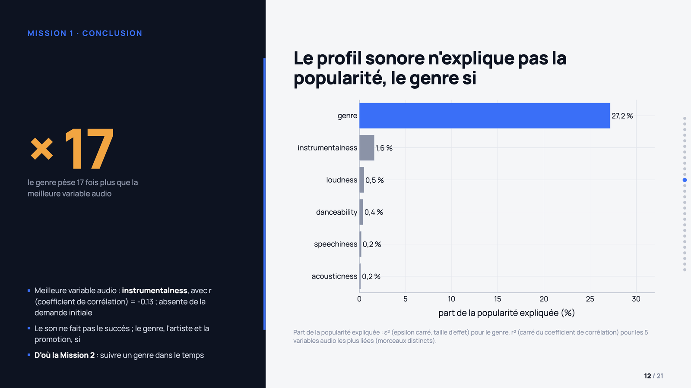
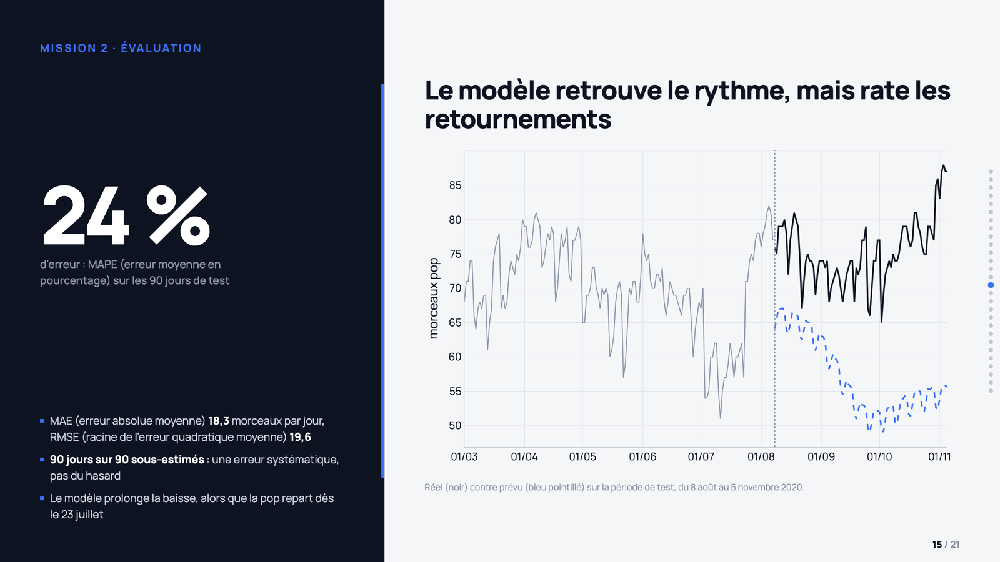

# 🎧 Music Streaming Trends: Statistical Analysis and Forecasting

**What makes a track popular, and where is pop music heading?** Inferential statistics on 114,000 tracks and Prophet forecasting on 9.8 million daily chart entries.

[](https://p9-streaming-musical.vercel.app)

👉 **[View the interactive presentation](https://p9-streaming-musical.vercel.app)** · Project 9 of the OpenClassrooms Data Analyst program · Deliverables (notebooks, slides) are in French.

## 📋 Business context

MeloWave is an independent music distributor (fictional case). Its Head of Music Insights wants her advice to labels to be based on data rather than intuition. She asks two questions:

1. **Today:** what makes a track popular?
2. **In six months:** will pop music rise or fall?

The goal is to help labels plan their release calendar: which genres to push, in which markets, and when.

## 🎯 Key results

- **Genre drives popularity, sound does not.** Genre explains **27%** of a track's popularity (Kruskal-Wallis ε²). No audio feature explains more than **2%**.
- **A p-value is not enough.** With 113,549 rows, almost everything becomes significant: danceability has a p-value of 4 × 10⁻³¹ yet explains only 0.1% of popularity. Every test is therefore paired with an effect size.
- **Pop is declining.** It went from 94 to 74 tracks on average in the global Top 200 between 2017 and 2020, and its share fell in **32 of 35 markets**.
- **Christmas remains its peak.** Every December, pop regains 26 to 32 places, with a yearly peak around December 17.
- **The forecast is a planning tool, not a precise figure.** Over 90 test days, the mean error is 24% (MAPE), with an MAE of 18.3 and an RMSE of 19.6 tracks per day. The model underestimates all 90 days: it extends the decline and misses the summer 2020 rebound.



## 📁 Data

| File | Content | Size |
|---|---|---|
| `spotify-tracks-dataset-detailed.csv` | Catalog: popularity and 11 audio features, 114 genres | 114,000 rows |
| `chart_tracks_genre_2017_2020.csv` | Daily Top 200 charts, 35 markets plus the global chart | 9.8M rows (1.4 GB) |
| `release_dates_genre_2017_2020.csv` | Release dates of charted tracks | 51,754 rows |

The data was provided by OpenClassrooms and is not included in this repository (see [`data/README.md`](data/README.md)).

## 🔬 Approach

### Part 1: catalog analysis ([notebook](notebooks/01_analyse_catalogue.ipynb))

- **Data quality audit:** 1 corrupted row and 450 exact duplicates removed. The 23,809 duplicated `track_id` values were kept: they are tracks listed under several genres, not errors.
- **Two views of the catalog:** one row per track and genre for genre analyses (113,549 rows), one row per track for artist rankings (89,740 tracks). Otherwise, multi-genre artists would be overrepresented.
- **Descriptive analysis:** distributions, skewness and kurtosis, outliers (IQR), artist rankings, audio profiles compared with a radar chart.
- **Statistical tests**, each chosen after checking its assumptions:

| Question | Assumption checked | Test | Effect size |
|---|---|---|---|
| Are energy and loudness related? | Normality (Shapiro-Wilk): rejected | Spearman | ρ = 0.75 (strong) |
| Does popularity depend on genre? | Normality within each genre: rejected | Kruskal-Wallis, ANOVA as a check, Dunn post-hoc with Bonferroni correction | ε² = 0.27 (large) |
| Does explicit content depend on genre? | Sufficient expected frequencies | Chi-square | Cramér's V = 0.40 |

- **Further analyses:** featurings, explicit content, musical key, one-hit wonders, and the four audio features left out of the original brief.

### Part 2: forecasting pop activity ([notebook](notebooks/02_prevision_series_temporelles.ipynb))

- **Daily time series:** number of pop tracks in the global Top 200. Missing dates were reinserted into a complete calendar so that gaps become visible.
- **Missing days:** 5 out of 1,405 (4 collection gaps, and 1 gap disguised as 200 empty rows). They are treated as missing values rather than zeros, which would have created false drops.
- **Prophet** with yearly and weekly seasonality. Chronological split: the last 90 days are held out as a test set and never seen during training.
- **Evaluation** with MAE, RMSE and MAPE, then a final six-month forecast with an 80% confidence interval.
- **Extras:** forecast of the monthly release cadence (with a discussion of truncation bias) and comparison of pop's share across the 35 markets.
- **Parameterized notebook:** genre and market can be changed in one line, and the whole analysis recomputes.



## 🎓 Skills

- Audit and clean a dataset, and document every decision
- Choose a statistical test after checking its assumptions (normality, expected frequencies)
- Interpret effect sizes, not only p-values
- Build a daily time series and diagnose missing dates
- Train and evaluate a forecasting model without data leakage
- Translate statistical results into recommendations for a non-technical audience

## 🛠️ Tech stack

| Tool | Use |
|---|---|
| Python 3, pandas, NumPy | Data preparation and analysis |
| SciPy, statsmodels, scikit-posthocs | Statistical tests and Dunn post-hoc test |
| Prophet | Time series forecasting |
| Plotly | Interactive charts, reused in the presentation |
| Jupyter | Analysis environment |

## 🗂️ Repository structure

```
├── notebooks/
│   ├── 01_analyse_catalogue.ipynb            Part 1: catalog and statistical tests
│   └── 02_prevision_series_temporelles.ipynb Part 2: daily series and Prophet
├── presentation/
│   ├── support_soutenance.html               Standalone presentation (21 slides and 7 appendices)
│   ├── support_soutenance.pdf                PDF version
│   ├── build_figures.py                      Recomputes the charts from the data
│   ├── assembler_support.py                  Inserts the charts into the template
│   ├── support_template.html                 Slide template
│   └── figures/                              Charts exported as JSON
├── images/                                   Screenshots used in this README
├── data/                                     Data location (not versioned)
└── requirements.txt
```

The notebooks are large because their Plotly charts are saved inside them. If GitHub does not render them, open them with nbviewer: [Part 1](https://nbviewer.org/github/bader28-lab/music-streaming-trends-forecasting/blob/main/notebooks/01_analyse_catalogue.ipynb), [Part 2](https://nbviewer.org/github/bader28-lab/music-streaming-trends-forecasting/blob/main/notebooks/02_prevision_series_temporelles.ipynb).

## ▶️ How to reproduce

```bash
pip install -r requirements.txt
# Put the three CSV files in data/
jupyter notebook notebooks/

# Rebuild the presentation
cd presentation
python build_figures.py && python assembler_support.py
```

## ⚠️ Limitations

- **A single forecast:** pop in the global chart. Other genres and markets remain to be evaluated.
- **A single train/test split.** Walk-forward validation over several periods would be more robust.
- **A systematic bias:** the model underestimates the whole test period and misses trend reversals. The forecast sets a calendar, but weekly chart monitoring is still needed.
- **Data stops at the end of 2020**, an atypical year.
- **Genre labels can be misleading:** in France, the "indie" category includes rappers.
- **Correlation is not causation:** the relationships measured are associations, not effects.
- **Success probably depends mostly on variables missing from the data**, such as artist notoriety and promotion.

## 🔒 Privacy

The data describes tracks and public charts. It contains no personal data about users.

## 👤 Author

**Bader B.**, Data Analyst in training at OpenClassrooms
